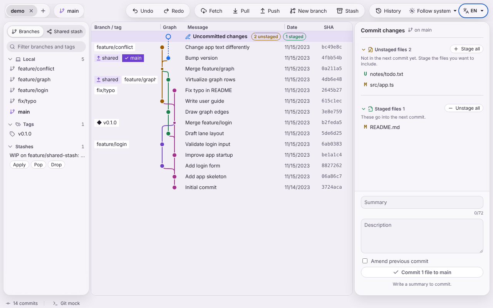

# Getting started

## Open a repository

- Start Git Atlas from the menu and press **Open repository…**, then pick the folder of a Git
  repository.
- Or start it with a path: `atlasgit /path/to/repo`.
- To open another repository next to the first one, press the `+` button after the repository
  tabs at the top left. Each repository gets its own tab; the `×` on a tab closes it.

If the folder is not a repository Git can open, you see **Could not open the repository** with
the reason and a fix (see [Troubleshooting](troubleshooting.md)).

When the repository has local changes, Git Atlas opens straight on the commit panel.

## The window

From top to bottom, left to right:

- Toolbar: Repository tabs, the current branch and, on old Git, a **Read-only (old Git)**
  badge. Then **Undo** and **Redo**; **Fetch**, **Pull**, **Push**, **New branch** and
  **Stash**; **History** (the operation journal); the theme and language pickers.
- Sidebar, with two views: **Branches** lists **Local** and **Remote** branches, **Tags** and
  **Stashes**, with a **Filter branches and tags** field on top. **Shared stash** lists the
  stashes your team shared (see [Shared stash](shared-stash.md)).
- Graph (centre): One row per commit, newest first, with the columns **Branch / tag**,
  **Graph**, **Message**, **Author**, **Date** and **SHA**. Narrow windows hide the author and
  date columns. The first row, **Uncommitted changes**, stands for your working directory and
  shows how many files are unstaged and staged.
- Diff (under the graph): Opens when you pick a file.
- Right panel: **Commit details** for the selected commit, or **Commit changes** when the
  uncommitted-changes row is selected.
- Status bar: Number of commits and the Git version Git Atlas uses.

Drag the borders between the panels to resize them; Git Atlas remembers the sizes.

## A first commit

1. Click **Uncommitted changes** at the top of the graph.
2. Press **Stage** next to each file you want in the commit (or **Stage all**).
3. Type a **Summary** (and a **Description** if you want), then press the commit button
   (it reads, for example, "Commit 1 file to main").
4. Changed your mind? Press **Undo** in the toolbar or in the message that appears at the bottom.

More in [Committing and undo](committing-and-undo.md).

## Git Atlas follows changes made elsewhere

Git Atlas watches the working directory. Files you edit in another program, and commits or
checkouts made in a terminal, show up on their own after a moment. If watching fails, a banner
says so; the view then refreshes each time the window gets focus.
