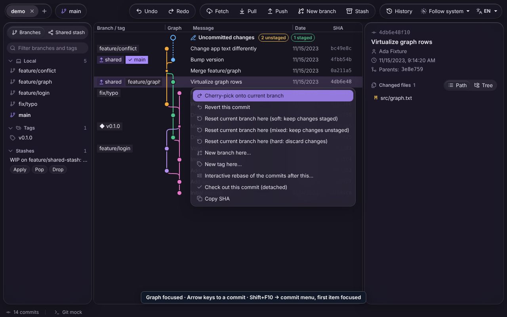

# Keyboard and accessibility

Everything in GitAtlas can be done with the keyboard. Every menu that opens with a right-click
also opens with the Menu key or Shift+F10.

## Shortcuts

### Everywhere

| Keys | Action |
|---|---|
| Ctrl+Z | Undo the last operation (not while typing in a field) |
| Ctrl+Shift+Z | Redo |
| Tab / Shift+Tab | Next / previous control. Order: toolbar, sidebar, graph, diff (when open), right panel |
| Ctrl+Shift+P | Show or hide the performance overlay (a developer aid) |

### Graph

| Keys | Action |
|---|---|
| ↑ / ↓ | Previous / next commit |
| Page Up / Page Down | One page up / down |
| Home / End | First / last commit. Home (or ↑ on the first commit) selects **Uncommitted changes** and opens the commit panel |
| Menu key or Shift+F10 | Menu of the selected commit (cherry-pick, revert, reset, new branch, new tag, interactive rebase, checkout, copy SHA) |

### Sidebar

| Where | Keys | Action |
|---|---|---|
| Branches and tags | Tab to the entry, Enter | Select its commit in the graph |
| Branches and tags | Menu key or Shift+F10 | Its menu: check out, merge into the current branch, rebase, new branch, rename, delete, push or delete a tag. This is the keyboard way to do what double-click and drag-and-drop do |
| Stashes | Tab to the stash message, then Enter, Menu key or Shift+F10 | Stash menu (share, apply, apply and remove). **Apply**, **Pop** and **Drop** follow with Tab |
| Shared stash | ↑ / ↓, Home / End | Move between shared stashes |
| Shared stash | Enter | Show its changes |
| Shared stash | Menu key or Shift+F10 | Its menu |

### Menus and dialogs

| Where | Keys | Action |
|---|---|---|
| Menus | ↑ / ↓, Home / End, Tab / Shift+Tab | Move between items (wraps around) |
| Menus | Enter or Space | Run the item |
| Menus | Escape | Close; focus goes back to the row the menu came from |
| Dialogs | Tab / Shift+Tab | Move between the dialog's controls; the window behind is not reachable |
| Dialogs | Enter | Submit (for dialogs with a text field) |
| Dialogs | Escape | Cancel; focus goes back to where the dialog was opened from |

### Commit panel, diff and panels

| Where | Keys | Action |
|---|---|---|
| **Description** field | Ctrl+Enter | Commit |
| Diff in full screen | Escape | Leave full screen |
| Panel borders (splitters) | ← / → (↑ / ↓ for the diff border) | Make the panel 16 px larger or smaller |
| Panel borders (splitters) | Home / End | Smallest / largest size |
| Toggle buttons (sidebar view, **Path** / **Tree**, **Unified** / **Split**, folded sections) | Enter or Space | Switch |

## Screen readers

GitAtlas was audited against WCAG 2.1 AA before this release; the audit, with every finding, is in
[docs/a11y/audit.md](../a11y/audit.md).

- The graph is drawn on a canvas, so GitAtlas keeps an invisible list of the rows next to it.
  A screen reader reads each commit as its branches and tags, message, author, date and SHA,
  with its position and whether it is selected. The current branch is read as "(current
  branch)", tags as "tag …", stashes as "stash …".
- The graph tells you that Shift+F10 or the Menu key opens the actions of the selected commit.
- Dialogs are announced with their title and keep focus inside until you close them.
- Messages at the bottom of the window and the file-watching banner are read as status
  messages; errors are read as alerts.
- Repeated buttons such as **Stage**, **Discard** or **Apply** are described by the file or stash
  they act on.

## Seeing and motion

- Both themes meet the WCAG AA contrast minimum for text, and the focus ring is visible on every
  surface.
- When your desktop asks for reduced motion (GNOME: Settings › Accessibility › Reduce
  animations), GitAtlas turns off its transitions and animations.
- Screen magnifiers that follow the focus follow the selected graph row.

## Known limits

- The graph column widths can only be changed with the mouse. They adapt to the window size.
- The graph column headers (**Branch / tag**, **Message**…) are not linked to the cells for
  screen readers; each row reads its cells in a fixed order instead.
- The checks so far used the accessibility tree of Chromium. Orca with the packaged app (WebKitGTK) is still to
  be checked.
